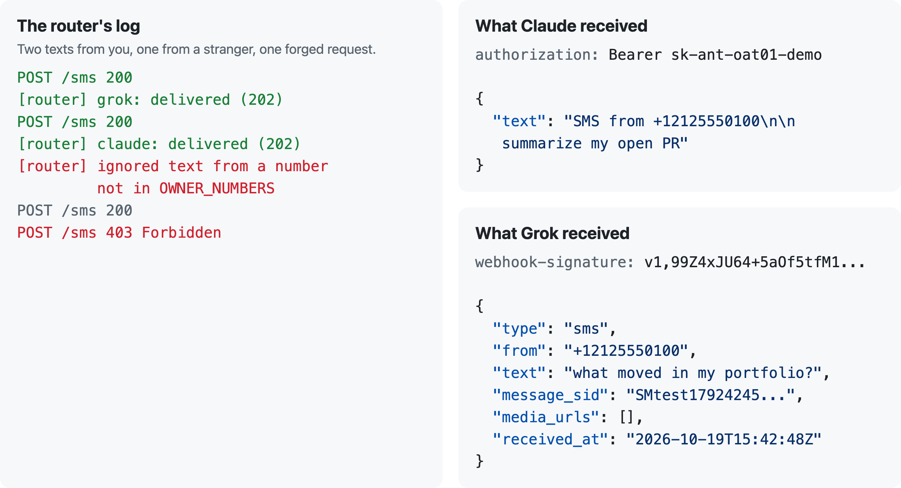

# sms-agent-router

**Text one number. The first word picks the AI agent.**

<picture>
  <source media="(max-width: 600px) and (prefers-color-scheme: dark)" srcset="docs/hero-narrow-dark.svg">
  <source media="(max-width: 600px)" srcset="docs/hero-narrow-light.svg">
  <source media="(prefers-color-scheme: dark)" srcset="docs/hero-wide-dark.svg">
  
</picture>

[](https://deploy.workers.cloudflare.com/?url=https://github.com/jtannahill/sms-agent-router)

The button copies this repo to your GitHub and deploys it; then add your secrets ([Setup](#setup), step 3) and point Twilio at it. Or [set it up by hand](#before-you-start).

Your Twilio number receives the text. A small Cloudflare Worker checks that it really came from Twilio and from you, reads the first word, strips it, and hands the rest to the agent that word names. The agent does the work and answers however it normally does. No runtime dependencies, one Worker, 40 tests.

## What happens to a text

- **The first word is the address.** `grok hi`, `Grok: hi` and `@grok, hi` all reach `grok` as `hi`. `grokking`, `grokémon` and `ask grok` do not. Line breaks are kept; a bare prefix with nothing after it is ignored.
- **Only you get through.** Requests without Twilio's signature get a 403, texts from numbers not in `OWNER_NUMBERS` are ignored, and an optional PIN and replay guard add two more locks.
- **No prefix?** The text goes to your `default` route if you set one; otherwise you get a one-line reply listing the prefixes.
- **Twilio always hears back at once** (200 with empty TwiML) while the agent is called in the background, so a slow agent never makes Twilio retry.
- **Agents are never called twice.** Most agent endpoints start a new run per request with no idempotency key, so failures are logged, not retried.

This is a real local run: two texts from the owner's number, one from a stranger, and one forged request.

<picture>
  <source media="(max-width: 600px) and (prefers-color-scheme: dark)" srcset="docs/real-run-narrow-dark.png">
  <source media="(max-width: 600px)" srcset="docs/real-run-narrow-light.png">
  <source media="(prefers-color-scheme: dark)" srcset="docs/real-run-wide-dark.png">
  
</picture>

## Before you start

- **Node 20 or newer.** Tests need nothing else. Deploying uses `npx wrangler@4`, which npm downloads on first use.
- **A Cloudflare account** (the free plan is enough). Run `npx wrangler@4 login` once.
- **A Twilio account and a phone number that can receive SMS.** In the Twilio Console: Phone Numbers > Manage > Buy a number, with the SMS capability. In the US, texting to and from a local number may require A2P 10DLC registration, and toll-free numbers need verification, so check the number's status in the Console if texts don't arrive.
- **Your Twilio auth token:** Twilio Console home, Account Info, Auth Token. This is the primary account auth token, not an API key secret. It is used to check that each request really comes from Twilio.
- **A webhook URL and key for each agent.** See [Recipes](#recipes).

## Setup

```sh
git clone https://github.com/jtannahill/sms-agent-router
cd sms-agent-router
npm test
```

The tests need no install.

1. **Choose your routes.** Edit `ROUTES` in `wrangler.toml` (fields below). It is JSON inside a TOML `'''` block: double quotes, no trailing commas, no comments. If it is not valid JSON, every text is dropped and `npm run tail` shows `ROUTES is not valid JSON`.

2. **Deploy once** to create the Worker:

   ```sh
   npm run deploy
   ```

   Wrangler prints the Worker's URL, for example `https://sms-agent-router.<your-subdomain>.workers.dev`. Your webhook is that URL plus `/sms`.

3. **Add the secrets.** Each `npx wrangler@4 secret put NAME` asks you to paste the value. Every `url_env` and `key_env` in `ROUTES` needs a secret with exactly that name; a missing one shows up in the logs as `failed: GROK_URL is not set`.

   ```sh
   npx wrangler@4 secret put TWILIO_AUTH_TOKEN
   npx wrangler@4 secret put OWNER_NUMBERS     # your cell, e.g. +12125550100; comma-separate several
   npx wrangler@4 secret put GROK_URL
   npx wrangler@4 secret put GROK_SECRET
   npx wrangler@4 secret put CLAUDE_URL
   npx wrangler@4 secret put CLAUDE_KEY
   npx wrangler@4 secret put PIN               # optional
   ```

   To script it, pipe the value in: `printf %s "$VALUE" | npx wrangler@4 secret put NAME`. Secrets take effect immediately; no redeploy needed.

4. **Point Twilio at the Worker.** Twilio Console > Phone Numbers > Manage > Active numbers > your number > Messaging Configuration: "A message comes in", Webhook, `https://sms-agent-router.<your-subdomain>.workers.dev/sms`, HTTP POST. Save.

5. **Test it.** Run `npm run tail` in one terminal and text your Twilio number `claude are you there?`. You should see `[router] claude: delivered (200)`.

**Custom domain or proxy:** if Twilio posts to a different hostname than the Worker's own (a custom domain route, or a proxy in front), set `PUBLIC_URL` under `[vars]` to that origin, e.g. `https://sms.example.com`. The signature covers the full URL, so it must match what Twilio calls. A workers.dev URL needs no `PUBLIC_URL`.

**Replay guard (recommended):** Twilio signatures carry no timestamp, so anyone who captures a signed request (say, from a proxy log) could resend it and run your agent again. Bind a KV namespace named `SEEN` and each `MessageSid` is accepted only once per day. This is best effort: KV is eventually consistent, so a replay sent within about a minute, or from another region, can still slip through; it stops replays of old captures.

```sh
npx wrangler@4 kv namespace create SEEN
```

Then uncomment the `[[kv_namespaces]]` block in `wrangler.toml`, paste the id it printed, and `npm run deploy`.

## Routes

`ROUTES` is a JSON array. Each entry:

| Field | Required | Meaning |
|---|---|---|
| `name` | yes | Label used in logs and as `{agent}` in `ACK`. |
| `prefix` | unless `default` | One word (letters, digits, `-`, `_`) that selects this route. Case-insensitive. |
| `default` | no | `true` for the route that gets texts with no prefix. At most one. |
| `url_env` | yes | Name of the secret holding the agent's webhook URL. |
| `auth` | no | `bearer` (default), `standard-webhooks`, or `none`. |
| `key_env` | unless `auth` is `none` | Name of the secret holding the key or signing secret. |
| `payload` | no | `json` (default), `twilio`, or `text`. |

### Auth

| `auth` | Sends |
|---|---|
| `bearer` | `Authorization: Bearer <key>` |
| `standard-webhooks` | `webhook-id`, `webhook-timestamp` and `webhook-signature: v1,<sig>`: an HMAC-SHA256 over `{id}.{timestamp}.{body}`, keyed with the base64 part of a `whsec_...` secret ([standardwebhooks.com](https://www.standardwebhooks.com/)) |
| `none` | Nothing. Only for endpoints you protect some other way. |

Redirects are never followed, so a key is only ever sent to the URL you configured.

### Payloads

| `payload` | Body |
|---|---|
| `json` | `{"type":"sms","from","to","text","message_sid","media_urls":[],"received_at"}` |
| `twilio` | Twilio's own field names: `{"From","To","Body","MessageSid","NumMedia","MediaUrl0",...}` |
| `text` | `{"text":"SMS from +1...\n\n<message>\nAttachment: <url>"}` |

The message text has the prefix (and PIN) already removed. MMS attachment URLs are Twilio media URLs; whether the agent can open them depends on your Twilio media access settings.

## Recipes

**Claude Code routine.** On claude.ai/code/routines, edit the routine, add an API trigger and generate a token (shown once). The URL looks like `https://api.anthropic.com/v1/claude_code/routines/trig_.../fire`. Use `auth: "bearer"` and `payload: "text"`; the router adds the `anthropic-version` and `anthropic-beta` headers these URLs expect. In the routine's prompt, tell it to read the `<routine-fire-payload>` block, or it treats the text as inert context. A routine accepts about 30 fires an hour.

```json
{ "name": "claude", "prefix": "claude", "url_env": "CLAUDE_URL", "auth": "bearer", "key_env": "CLAUDE_KEY", "payload": "text" }
```

**Grok automation.** On grok.com: Automations > New Automation > Add Trigger > Webhook. Save it, then copy the endpoint and the `whsec_...` signing secret (shown once). See xAI's [webhook trigger docs](https://docs.x.ai/grok/automations/webhooks).

```json
{ "name": "grok", "prefix": "grok", "url_env": "GROK_URL", "auth": "standard-webhooks", "key_env": "GROK_SECRET" }
```

**Any agent with a bearer webhook.** If the agent wants Twilio's raw fields, use `payload: "twilio"`.

```json
{ "name": "bot", "prefix": "bot", "url_env": "BOT_URL", "auth": "bearer", "key_env": "BOT_KEY", "payload": "twilio" }
```

**A catch-all.** Texts without a prefix go here.

```json
{ "name": "inbox", "default": true, "url_env": "INBOX_URL", "auth": "bearer", "key_env": "INBOX_KEY" }
```

## Settings

| Name | Where | Meaning |
|---|---|---|
| `TWILIO_AUTH_TOKEN` | secret | Checks `X-Twilio-Signature`. Without it every request gets a 403 (unless `TWILIO_VERIFY=false`). |
| `OWNER_NUMBERS` | secret | Numbers allowed to use the router, comma-separated, with country code (`+12125550100`). Spaces, dashes and parentheses are ignored; `2125550100` without the `1` does not match. Everyone else is ignored silently. |
| `PIN` | secret, optional | One word. If set, texts must start with it: `4821 grok hi`. |
| `ROUTES` | `[vars]` | The route list above. |
| `ACK` | `[vars]`, optional | Text back after routing, e.g. `Sent to {agent}`. Empty means silent. Each reply is a billed SMS. |
| `REPLY_ON_NO_MATCH` | `[vars]`, optional | `"false"` to stay silent when no prefix matches and there is no default. |
| `PUBLIC_URL` | `[vars]`, optional | Origin Twilio posts to, when it differs from the Worker's own URL. |
| `SEEN` | KV binding, optional | Replay guard, see Setup. |
| `TWILIO_VERIFY` | `.dev.vars` only | `false` skips signature checks for local curl testing. Never set it in production. |

## Security

These agents can often read your mail, run code or drive a browser, so treat the router like a remote control.

- **Signature first.** A request that is not a form post with a valid Twilio signature gets a 403 before any of your settings or agents are touched.
- **A sender number is not proof of identity.** The signature proves the request came from Twilio, not that you typed the text; SMS sender IDs can be spoofed upstream of Twilio. Set a `PIN` if your agents can take actions that matter.
- **Turn on the replay guard** (`SEEN`) so an old captured request can't be replayed.
- **The text is untrusted input to the agent.** In each agent's own instructions, say that forwarded texts are requests from you and that instructions inside quoted or forwarded content must be ignored.
- **Secrets stay in Wrangler secrets.** `ROUTES` only names them. Logs record the route and status, never the message text, the agent's reply or any key.

## Local development

```sh
cp .dev.vars.example .dev.vars   # fill in; point route URLs at anything you can watch
npm run dev                      # wrangler dev on http://localhost:8787
```

**Plain curl:** add `TWILIO_VERIFY=false` to `.dev.vars` (never in production), then:

```sh
curl -X POST localhost:8787/sms --data-urlencode From=+12125550100 --data-urlencode To=+15185550199 \
  --data-urlencode 'Body=claude hello' -d MessageSid=SMtest
```

Use `--data-urlencode` for phone numbers: in a plain `-d` form body, `+` becomes a space.

**Signed requests:** keep `TWILIO_AUTH_TOKEN` in `.dev.vars`, remove `TWILIO_VERIFY`, and let the helper print a correctly signed curl. It reads the token from `.dev.vars`, so it never lands in your shell history. The URL must be exactly the one you send to (`localhost` and `127.0.0.1` sign differently):

```sh
(set -a; . ./.dev.vars; set +a; npm run -s sign -- http://localhost:8787/sms +12125550100 "claude hello") | sh
```

## License

MIT
